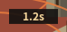

# Boss預警不再被城心與密集部隊蓋住

## 玩家差異與修改

正式Renderer原本在建築／單位之前的drawZones畫Boss符印與倒數。受控城心屋頂場景中，即使Canvas確實呼叫fillText，倒數最後仍被屋頂完全覆蓋。

`js/renderer.js` 保留地面危險區原繪製位置與幾何，將原drawBossStrike符印／倒數移到獨立drawBossWarnings：物件、粒子、建造預覽及大氣之後，drawVisibility迷霧之前。原符印形狀、倒數演算法、範圍、傷害與計時都沒改；沒有穿越迷霧的新層級，沒有改碰撞、視野、Game更新或RNG。

這是可重現的顯示遮擋缺陷，不宣稱是玩家B當時只看到0.4秒的全部原因；代理觀察延遲仍可能影響原場次。

## 前後畫面

完整場景另見before.png／after.png；是受控靜態城心、30名追加單位及Boss警示，非自然戰役截圖。

## 驗證

Node先以新層級測試重現舊版FAIL，原輸出保留；修正後5檔PASS：boss-warning-layer、boss-countdown、boss-warning-viewport、boss-phase-audio、boss-impact-audio。驗證真實Renderer.draw方法順序、地面不重複畫符印、只繪Boss、倒數與zone不變；既有邊界、計時及音效排程測試未刪改。

Chromium154.0.8037.57，兩Boss警示樣式×縮放0.6／1／1.6×elapsed0／1.2／2×DPR1／2×前後版本，共72組。既有delay仍2.4秒，顯示2.4s／1.2s／0.4s；這是靜態取樣，不重寫計時器或模擬自然等待。

- 修改前36組：倒數矩形範圍的像素與「不畫Boss符印」基線完全相同，確認被屋頂完全遮住。
- 修改後36組：與「物件上層、迷霧下層」同Canvas參考零像素差異。
- 每組序列化Game.snapshot（排除savedAt）及兩個RNG均未被繪圖改變。不是全機器狀態或硬體性能認證。
- 正式本地構建來源 `e07cab7daebe7c6fe3316f4d4bdfb6f2c0c08a47`，168個資源SHA-256通過。比較前版為 `bf2780686d3b75ced3360e73b3c45832f2abe1b2`，屬最新基線的相同前版執行資源。

## 像素參考失敗完整保留

第一版把原符印畫到另一Canvas，且是在正式迷霧合成之後當參考；新版首例仍有374通道差異。將參考改不透明模式未解決；改全畫布座標及保存診斷圖仍有369通道差異。因此沒有把透明度或抗鋸齒假設當成已證實原因，也沒有把可見相似當PASS。

參考契約後來修正為與需求相同：同一正式Canvas，在物件／大氣後、迷霧前獨立注入原符印，再與正式Renderer實際輸出比較。先只驗失敗單例，零差異後才重跑完整72組。此參考不讀新drawBossWarnings的結果，明確指定預期層級；前版仍36組被遮住，新版36組零差異。沒有放寬像素容差、改遊戲程式求綠或刪除失敗。所有嘗試JSON及小型actual／expected圖均保留。

## 所有權與限制

安全基線 `3c8e93be82906e8c3b71f5a87f541d57914e9a59`；有效Strategy遠端 `e77e0a3afe7415bdadb6d5f3ac6c92ebf31d308d`。核對Ownership v397後Dry Run→CAS→正常Push取得v398，收據 `6b6b8f6e95a015482616db70ef986626092ad555`。

獨立任務 `BOSS-WARNING-LAYER-8A24C6D1`，Agent `boss-warning-layer-8a24c6d1`，Execution `boss-warning-layer-20261125-8a24c6d1`，分支 `codex/riftwatch-boss-warning-layer-8a24c6d1`。沒有接管或修改原Boss、英雄、Fun Lab或Progress Feed Owner。未改main、Pages、公開版本或RC；未部署，不宣稱背景排程驗收。

NOT_TESTED：真人反應／趣味、自然完整戰役、四語本輪重測（無新文字）、Save／Load／NG+重測、100／200單位性能、Windows實體GPU、影片。Node音效測試不是人耳聽感驗收；Canvas比較也不是硬體性能PASS。

另見GDD issue-8-snapshot第247行「Boss專技另依3–4秒紅區」，現行程式及既有測試使用2.4秒。最新Strategy保留GDD；本輪只修繪製，不自行選擇新的數值。下一步需核對正式決策繼承與較新授權，必要時標SPEC_DECISION_REQUIRED；不可用本輪成果宣稱預警時間規格已完成驗收。
